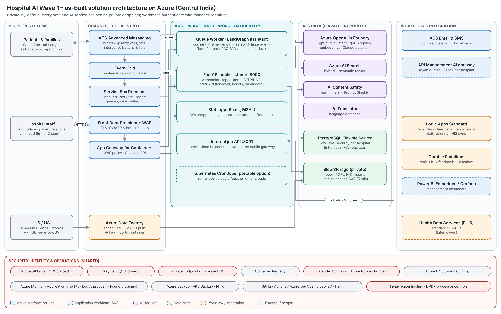

# Hospital AI – Wave 1 platform (hcwave)
# =====================================================


hcwave test
One platform for five hospital patient-engagement products that share the same
WhatsApp number, database and patient records:

| Module | What it does |
|---|---|
| WhatsApp patient assistant | Booking / rescheduling / cancellation with buttons and lists, doctor availability, FAQ answers from the hospital's own content (Malayalam, English, Hindi), emergency detection, human handover |
| Reminders | 24 h (Confirm / Reschedule / Cancel), 2–3 h preparation, missed appointment, follow-up due – sent exactly once |
| Report delivery | No PDFs in chat: expiring link → OTP or date of birth → 5-minute signed URL, fully audited |
| Feedback & reputation | 0–10 score + comment, AI tagging, service-recovery tickets with WhatsApp/email alerts and SLA escalation, Google review invite for everyone |
| Management dashboard | Access, appointments, reports and experience KPIs (Power BI Embedded, Grafana or built-in) + daily 5-line briefing |



**Full as-built architecture, security design and step-by-step deployment
instructions:** [`docs/Hospital_AI_Wave1_As-Built_Solution_Architecture.docx`](docs/Hospital_AI_Wave1_As-Built_Solution_Architecture.docx)

## Stack

Azure Communication Services (WhatsApp, SMS, Email) · Event Grid · Service Bus ·
AKS · Logic Apps Standard · Durable Functions · Azure OpenAI in Microsoft Foundry
(Claude optional) · Azure AI Search · AI Content Safety + Prompt Shields ·
AI Translator · PostgreSQL Flexible Server · Blob Storage · Entra ID ·
Key Vault + Workload ID · Application Gateway for Containers / Front Door WAF ·
API Management (optional) · Private endpoints · Azure Monitor / Application
Insights · ACR · Azure Backup · Defender for Cloud / Policy / Purview ·
Data Factory / FHIR · Bicep · Helm · GitHub Actions or Azure DevOps.

Application code: Python 3.12 (FastAPI, LangGraph, LangChain, SQLAlchemy),
React 18 staff app, Azure Functions (Python).

## Principles

- **Configurable** – behaviour, providers, timers, templates and texts live in
  YAML (`config/`); secrets only in environment variables (`.env` locally,
  Key Vault via the CSI driver in AKS).
- **Secure & private** – private endpoints, managed identities everywhere (no
  keys in code), WAF, PostgreSQL row-level security per hospital, PII-masked
  logs, hardened non-root read-only containers.
- **Portable** – domain code depends on ports; every cloud integration is an
  adapter selected in YAML (`provider: …` or `module:Class`). The WhatsApp
  channel can be swapped for Meta Cloud API or any other messaging app by
  writing one class. The Helm chart runs on AKS, EKS, GKE or on-premises.
- **Infrastructure as code** – one Bicep deployment per environment, one Helm
  release for the application, CI/CD pipelines for both.

## Quick start (laptop, offline – no cloud account needed)

```bash
cp .env.example .env
docker compose up --build          # Postgres+pgvector, Redis, API, worker, staff UI
curl -XPOST localhost:8000/dev/simulate -H 'content-type: application/json' -d '{"text":"hi"}'
open http://localhost:5173          # staff app (sign-in disabled in dev)
open http://localhost:8000/docs     # API docs
```

Reply to the bot with the `reply_id` values it returns (for example
`{"reply_id":"menu:book"}`) to walk through a booking.

## Repository layout

```
config/                  YAML configuration (app, environments, hospitals, templates, locales, prompts, FAQ)
services/backend/        Python package: API, worker, jobs, adapters, domain, LangGraph agent, migrations, tests
services/staff-ui/       React staff app (takeover inbox, complaints, dashboard, front desk)
services/functions/      Durable Functions (feedback orchestration)
workflows/logic-apps/    Logic Apps Standard recurrence workflows
infra/bicep/             Subscription-scope Bicep (main.bicep + modules + parameters)
deploy/helm/hcwave/      Helm chart (values, values-azure, values-local)
deploy/local/            Postgres, Redis, MinIO for local Kubernetes
scripts/                 deploy-infra, entra-apps, install-cluster-addons, db-bootstrap, deploy-app, deploy-workflows
docs/                    As-built Word document, diagrams and their generator
```

## Deploy to Azure (summary)

```bash
export HCWAVE_ADMIN_GROUP_ID=<entra-group-object-id> HCWAVE_ADMIN_GROUP_NAME=<group-name>
make infra-whatif ENV=dev && make infra ENV=dev     # Bicep → deploy/generated/dev.env
make entra ENV=dev UI_URL=https://staff.<domain>    # Entra app registrations
#   connect WhatsApp in ACS (portal), submit templates (docs Appendix A)
make addons ENV=dev                                 # ALB controller, cert-manager
make db-bootstrap ENV=dev                           # Entra role for the workload identity
make deploy ENV=dev                                 # build images in ACR + Helm release
make workflows ENV=dev                              # Logic Apps + Durable Functions
```

Details, prerequisites, verification items and the go-live checklist are in
section 11 of the as-built document.

## Development

```bash
cd services/backend
pip install -e ".[dev,azure,portable]"
TEST_DATABASE_URL=postgresql+asyncpg://postgres@localhost:5432/hcwave_test pytest   # 48 tests
ruff check src tests migrations && ruff format --check src tests migrations         # Google style
```

`make help` lists all developer and operator commands. Regenerate the
document and diagrams with `make docs`.
